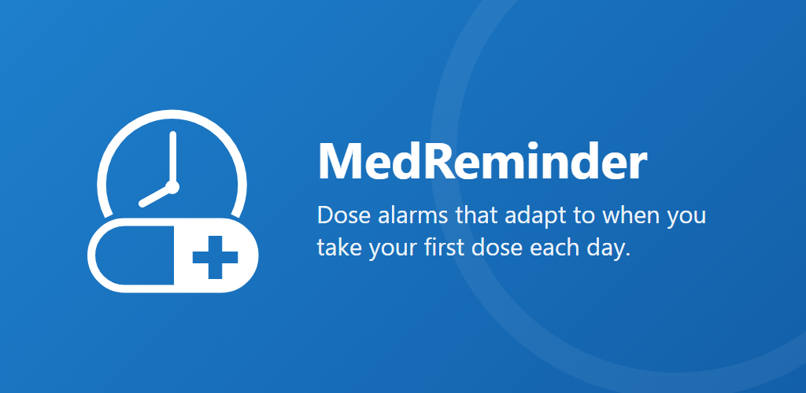
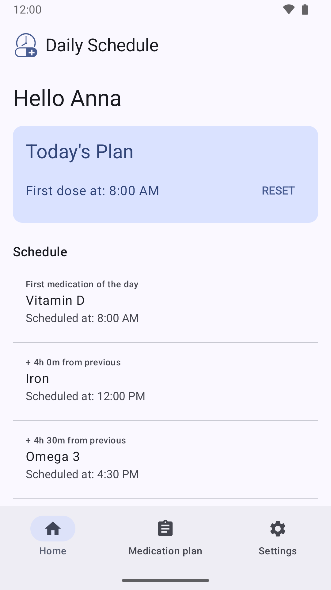
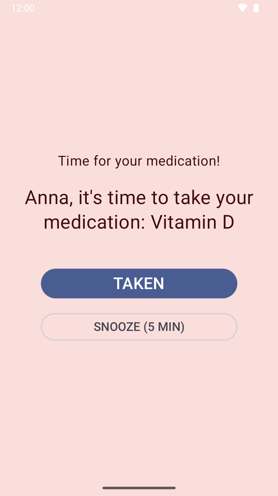
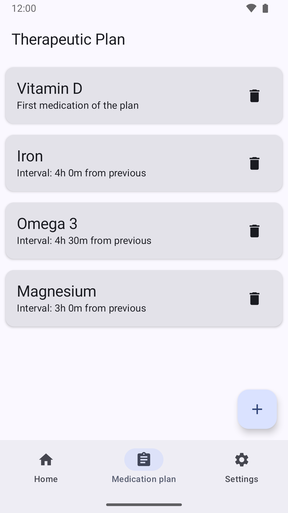
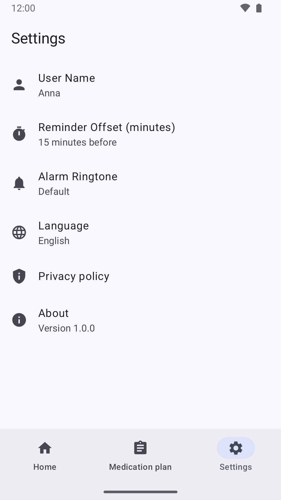

<p align="center">
  
</p>

<p align="center">
  <a href="https://github.com/dallanoce/MedReminder/actions/workflows/build.yml"></a>
  <a href="https://github.com/dallanoce/MedReminder/actions/workflows/tests.yml"></a>
  
  
  
  <br>
  
  
  
  
  <a href="https://dallanoce.github.io/MedReminder/privacy-policy.html"></a>
</p>

# MedReminder

MedReminder is an Android app that reminds you to take every dose of your daily therapy on time.
You enter your plan once: your medications in the order you take them, and how long after the
previous one each is due. Each day you record when you take the first dose, and MedReminder works out
the time of every dose that follows and rings an alarm for each one. The alarm gets through whether the
phone is locked or you are using another app.

No account, no ads, no internet access: your plan never leaves your phone.

## Screenshots

| Today's schedule | The dose alarm | Your therapy plan | Settings |
|:---:|:---:|:---:|:---:|
|  |  |  |  |

## Main features

### A schedule that follows your day

Tap **Set first dose time** when you take your first medication. Home then lists every dose of the day
with its time: in the example above, a first dose at 8:00 AM puts the next medication 4 hours later at
12:00 PM, the one after that at 4:30 PM, and so on. Start later and every time moves with you. Times
follow your 12/24-hour setting and are marked *(tomorrow)* when a schedule runs past midnight.
The schedule clears itself overnight (at 3:00 AM, but never before its last dose), ready for the next day.

### An alarm that gets through

At each dose time MedReminder rings on the **alarm volume** until you react:

- **Phone locked**, even with a PIN: the alarm screen appears over the lock screen.
- **Using another app**: the alarm screen takes over (with *Display over other apps* allowed),
  otherwise a ringing notification with the same buttons.
- **Taken** stops it; **Snooze** rings again in 5 minutes. Two doses due together are shown one at a time.
- An optional **early reminder** rings once a few minutes before each dose.
- Alarms survive a reboot and the phone's deep sleep (Doze), using Android's alarm-clock API.

A setup screen asks for the four permissions this needs (notifications, alarms & reminders, full-screen
notifications, display over other apps), and Home warns you while any of them is missing.

### Your therapy plan

Add your medications in the order you take them. For each one after the first, set the interval from
the previous dose (up to 24 hours, to the minute). Editing the plan updates the alarms of a schedule
already running.

### Settings

- Your name, used in the greeting and on the alarm screen.
- The early reminder, from 0 (off) to 120 minutes before each dose.
- The alarm ringtone. If the chosen one is removed, the default alarm sound plays instead of silence.
- The language: English, Italian, or the system language.
- Links to the privacy policy and the app version.

The app also follows the system dark theme, uses your wallpaper colors on Android 12+, and stays readable
at large font sizes.

## Privacy

- The app has **no internet permission** and contains no analytics, ads or third-party SDKs.
- Your plan and settings are stored only on the phone. They are excluded from cloud backups, but they move
  with a direct phone-to-phone transfer.
- Full details: [privacy policy](https://dallanoce.github.io/MedReminder/privacy-policy.html).

## Download

MedReminder is being prepared for Google Play. Until then you can build it from source (below).
Each run of the [Build workflow](https://github.com/dallanoce/MedReminder/actions/workflows/build.yml)
also attaches a debug APK (you need to be signed in to GitHub to download it).

> On Android 15+, an APK installed from a file needs *App info → ⋮ → Allow restricted settings* before
> *Display over other apps* can be turned on. Apps installed from Google Play aren't affected.

## Building from source

Requirements: JDK 17 or newer (Android Studio's bundled JDK works) and the Android SDK with API 36.

```bash
./gradlew assembleDebug          # debug APK in app/build/outputs/apk/debug/
./gradlew testDebugUnitTest      # unit tests
./gradlew lintRelease            # lint, report in app/build/reports/
./gradlew bundleRelease          # release App Bundle (signed if keystore.properties exists)
```

Release signing reads `keystore.properties`, which is git-ignored; without it, release builds are unsigned.
See [docs/RELEASE.md](docs/RELEASE.md) for the upload key and the release steps.

## Tests

- **Unit tests** (`app/src/test`): the dose schedule, the daily reset, input validation and the
  today/tomorrow labels. They run on every push to `main`.
- **Instrumented tests** (`app/src/androidTest`): the Room database and its schema migrations. They need a
  device or emulator: `./gradlew connectedDebugAndroidTest`.
- **Manual alarm matrix**: every phone state the alarm must get through, in
  [docs/TESTING.md](docs/TESTING.md).

## Project structure

```
app/src/main/java/io/github/dallanoce/medreminder/
├── alarm/         scheduling (AlarmManager), the alarm screen, notifications, daily reset
├── data/local/    Room database (the plan) and DataStore (the day's state and settings)
├── permissions/   the four alert permissions and their status
└── ui/            Compose screens (Home, plan, settings, permission setup), view model, theme
docs/
├── RELEASE.md, TESTING.md, privacy-policy.md
└── play-store/    store listing texts, Play Console answers, graphics
```

Built with Kotlin, Jetpack Compose (Material 3), Room, DataStore and Navigation Compose.

## Disclaimer

MedReminder is a reminder tool. It is not a medical device and does not diagnose, treat, cure or prevent
any medical condition. Always follow the instructions of your doctor or pharmacist.
